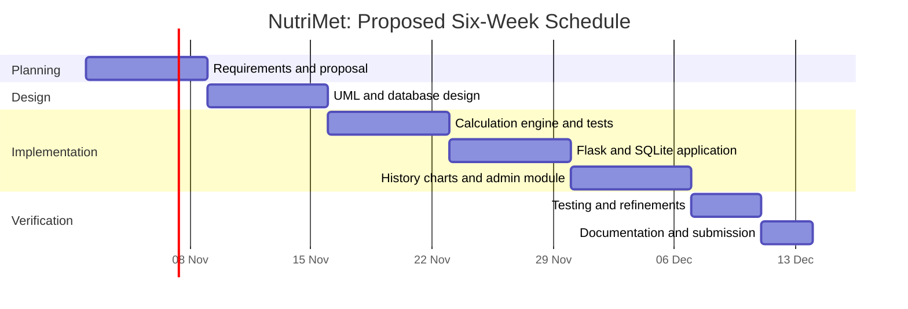
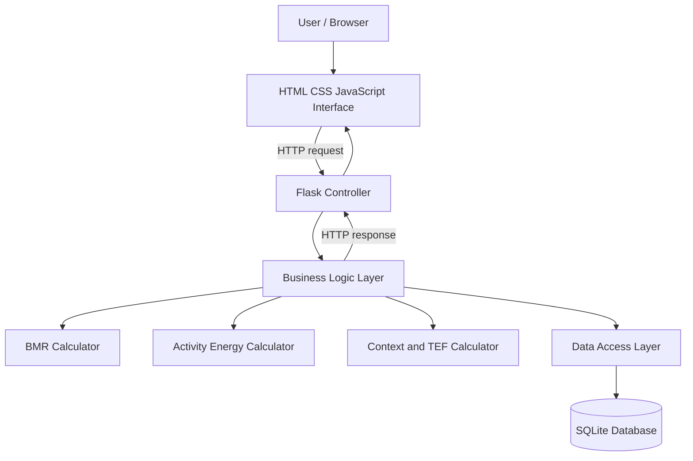
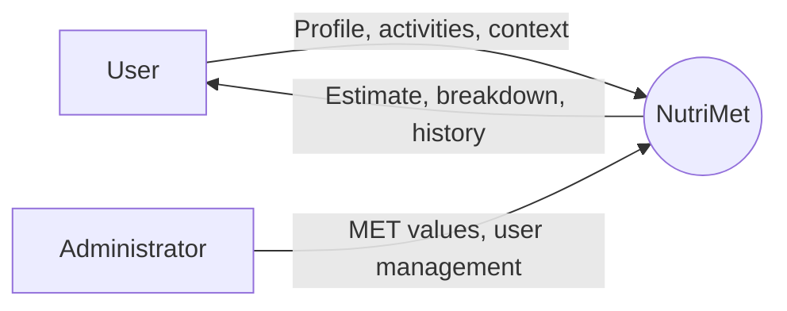
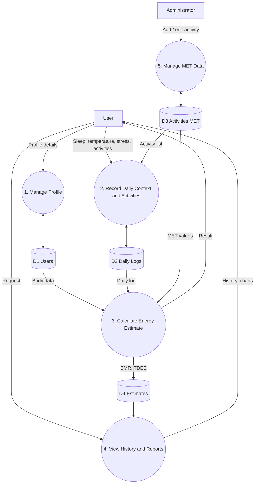
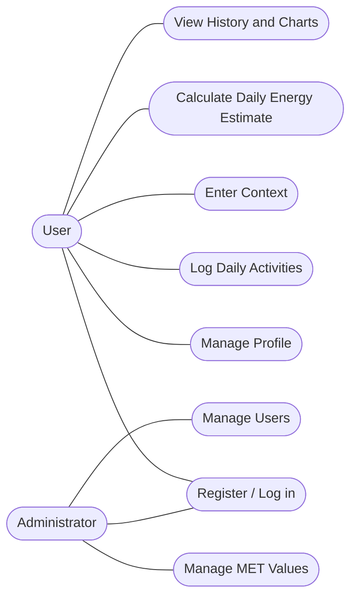
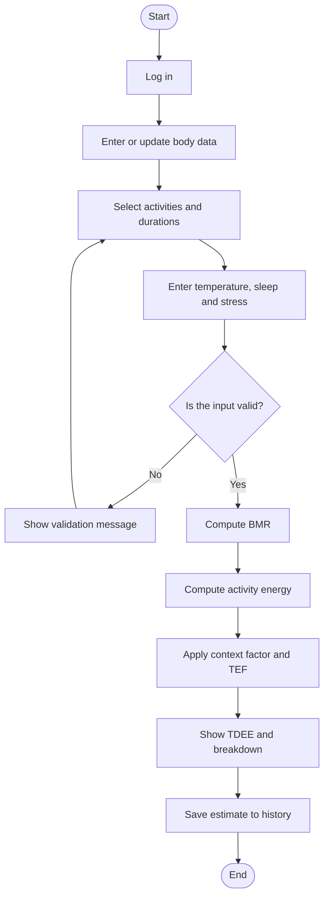
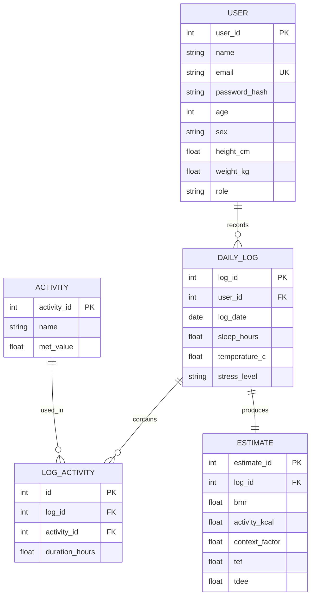
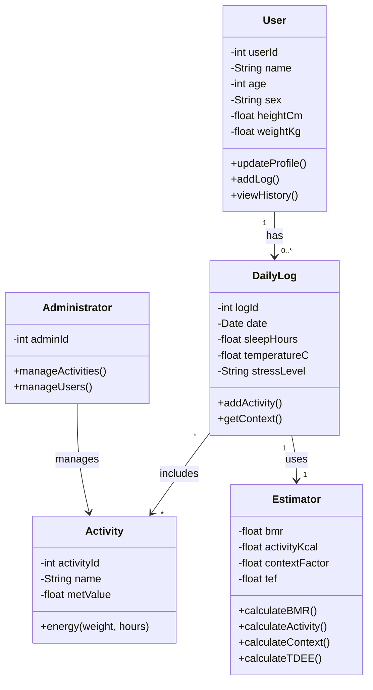
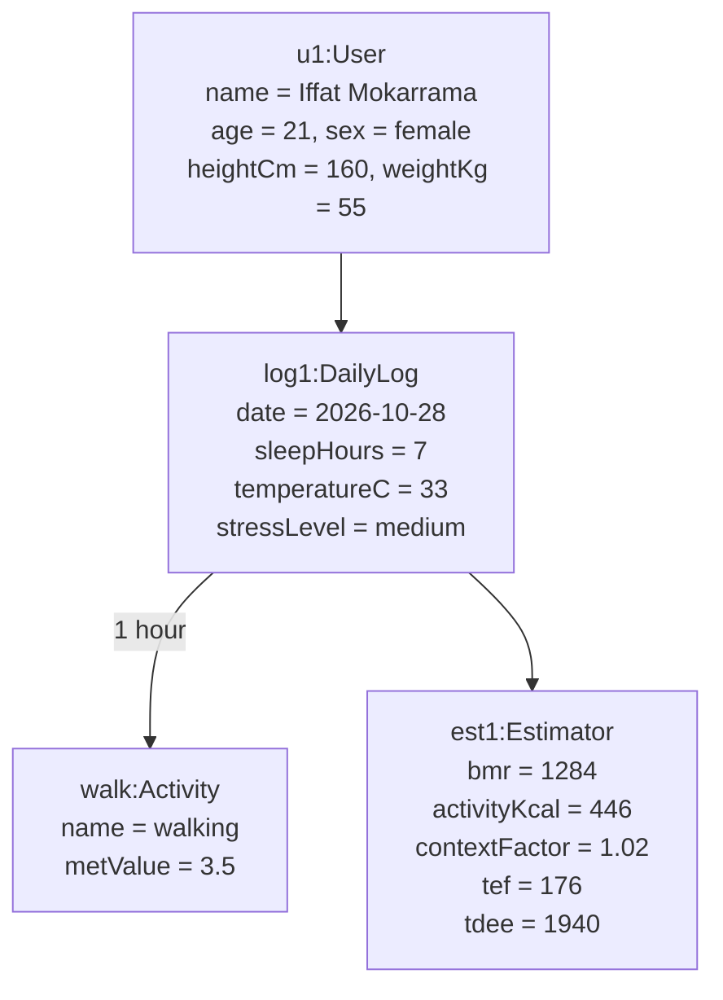

# NutriMet
### Context-Aware Daily Calorie & Energy Expenditure Estimator
### Final Capstone Project Proposal

> **Tagline:** Know Your Day. Understand Your Energy. Eat With Confidence.

**Project type:** Web-based health and nutrition estimation system  
**Prepared by:** Iffat Mokarrama  
**Student ID:** IT24035  
**Institution:** Mawlana Bhashani Science and Technology University, Department of Information and Communication Technology

---

## 1. Executive Summary

NutriMet is a web-based application that estimates how many calories a person uses in a day. Instead of applying one fixed activity multiplier, it combines the user's body profile, the activities actually performed, and the context of the day (temperature, sleep and stress). It shows a clear breakdown of where the energy goes and keeps a daily history so users can compare their days.

The first version uses a transparent, rule-based calculation engine built on published formulas, so it can be implemented and tested without any paid service. The system will use HTML, CSS and JavaScript for the interface, Python with Flask for server-side logic, and SQLite for data storage.

The project follows the **Incremental Software Development Model**. The calculation engine is built first, followed by the database and profile, then logging and history, and finally the administrator module and testing.

## 2. Introduction and Background

Students and young adults often track calories with generic online calculators. These tools multiply basal metabolic rate (BMR) by a fixed factor (sedentary, moderate, active) and show one number for every day. In reality, energy use changes with movement, sleep, weather and stress.

The Mifflin-St Jeor equation, the Compendium of Physical Activities (MET values) and research on the thermic effect of food provide well-established building blocks. NutriMet combines them into one explainable estimate. It is suitable as a capstone project because it covers interface design, object-oriented programming, database design, software process planning and system modelling.

## 3. Problem Statement

Existing calorie calculators use one fixed activity multiplier for all days, ignore daily context such as sleep, temperature and stress, rarely show how the final number was produced, and do not keep a history for comparison. As a result, the estimates are too general to be useful for daily planning.

The proposed system brings profile, activities and context together in one application and explains the result step by step.

## 4. Project Aim and Objectives

### 4.1 Main Aim

To design and prototype a web-based estimator that calculates daily calorie and energy expenditure by considering the user's body profile, daily activities and context.

### 4.2 Specific Objectives

1. Allow users to register, log in and manage a body profile.
2. Allow users to log daily activities with durations.
3. Allow users to enter context: temperature, sleep hours and stress level.
4. Calculate BMR using the Mifflin-St Jeor equation.
5. Calculate activity energy using MET values.
6. Apply a context factor and the thermic effect of food (TEF) to produce total daily energy expenditure (TDEE).
7. Display a breakdown of BMR, activity, context and TEF.
8. Save every estimate and show history and simple charts.
9. Provide an administrator interface for managing MET values and users.
10. Document the system with UML and data-flow diagrams and test the main use cases.

## 5. Proposed Solution

The user enters age, sex, height and weight once. Each day they select the activities they did, enter durations, and add the day's context. The calculation engine then produces:

1. **BMR** from the profile
2. **Activity energy** from MET values and durations
3. **Context-adjusted energy** using temperature, sleep and stress factors
4. **TEF** added on top
5. **TDEE**, shown together with a breakdown

**Example scenario:** A student sleeps 7 hours, studies 6 hours, walks 1 hour, sits 6 hours and cooks 1 hour on a hot day with medium stress. A fixed-multiplier calculator would give one generic number. NutriMet reports the exact contribution of each part and applies the stress and temperature adjustments.

## 6. Scope

### 6.1 Included in the Initial Version

- User registration and login with two roles (User, Administrator)
- Body profile management
- Daily activity logging with durations
- Context input: temperature, sleep, stress
- BMR, activity, context factor and TEF calculation
- Result page with a clear breakdown
- Estimate history and simple charts
- Administrator management of MET values and users
- Testing, documentation and GitHub version control

### 6.2 Outside the Initial Version

- Medical diagnosis or treatment advice
- Wearable device or sensor integration
- Automatic food image recognition
- Meal planning and diet recommendation
- Native mobile applications
- Social features and sharing
- Cloud deployment and microservices

## 7. Stakeholders and Users

| Stakeholder | Interest / Responsibility |
|---|---|
| User | Keeps a profile, logs activities and context, views estimates and history |
| Administrator | Manages the activity/MET list and user accounts |
| Project developer | Designs, implements, tests and documents the system |
| Supervisor / evaluator | Reviews the proposal, diagrams, implementation and demonstration |

## 8. Functional Requirements

| ID | Requirement |
|---|---|
| FR-01 | The system shall allow a user to register, log in and log out. |
| FR-02 | The user shall be able to create and update a profile (age, sex, height, weight). |
| FR-03 | The user shall be able to select activities and enter durations for a day. |
| FR-04 | The user shall be able to enter temperature, sleep hours and stress level. |
| FR-05 | The system shall calculate BMR using the Mifflin-St Jeor equation. |
| FR-06 | The system shall calculate activity energy using (MET − 1) × weight × hours. |
| FR-07 | The system shall apply a context factor and TEF to produce TDEE. |
| FR-08 | The system shall display a breakdown of BMR, activity, context and TEF. |
| FR-09 | The system shall save every estimate and show the user's history. |
| FR-10 | The administrator shall add, edit and remove activities and MET values. |
| FR-11 | The administrator shall view and manage user accounts. |
| FR-12 | The system shall validate input and show understandable error messages. |

## 9. Non-Functional Requirements

- **Usability:** Simple forms and a clear result page that can be used without training.
- **Performance:** An estimate is produced in under two seconds under normal conditions.
- **Reliability:** Invalid values (for example a negative weight) are rejected and never saved.
- **Security:** Passwords are stored as hashes; admin pages are role-protected; secrets are never committed to GitHub.
- **Privacy:** Only data needed for estimation is collected.
- **Maintainability:** Calculation logic is separated from the interface and the data layer.
- **Portability:** Runs in modern browsers and adapts to different screen sizes.
- **Accessibility:** Labels, keyboard-operable controls and readable contrast.

## 10. Technology Stack

| Technology | Purpose |
|---|---|
| HTML5 | Page structure |
| CSS3 | Responsive layout and styling |
| JavaScript (Chart.js) | Client-side interaction and history charts |
| Python 3 | Calculation engine and business logic |
| Flask | Server-side request handling |
| SQLite | Persistent relational data storage |
| pytest | Unit testing |
| Git and GitHub | Version control, source hosting and submission |

**Implementation note:** The repository currently contains the working calculation engine (`src/`), the MET dataset (`data/`), unit tests and the proposal documents. The Flask web interface and SQLite storage are planned increments and are not yet implemented.

## 11. Software Process Model

The project uses the **Incremental Model**. Each increment adds a usable set of features and is reviewed before the next begins.

### Why this model?

- The project is built in manageable stages by one developer.
- The calculation engine can be tested before the web interface exists.
- Feedback can be added after each increment.
- Each feature can be tested separately.

### Development increments

1. **Increment 1: Requirements and design.** Requirements, use cases, data model and wireframes.
2. **Increment 2: Calculation engine.** BMR, MET activity energy, context factor, TEF and unit tests.
3. **Increment 3: Database and interface.** SQLite schema, Flask routes, profile and daily log pages.
4. **Increment 4: History and admin.** Result page, history charts, MET management.
5. **Increment 5: Testing and refinement.** System testing and bug fixing.
6. **Increment 6: Delivery.** Documentation, screenshots, demonstration and GitHub submission.

## 12. Schedule, Milestones, and Deliverables

| Week | Activities | Milestone | Deliverable |
|---|---|---|---|
| 1 | Define problem, objectives, scope and requirements | M1: Proposal approved | Proposal and requirements list |
| 2 | Create DFD, Use Case, Activity, ER, Class and Object diagrams | M2: Design completed | Design documentation |
| 3 | BMR, MET energy, context factor, TEF and unit tests | M3: Engine ready | Tested calculation engine |
| 4 | SQLite schema, Flask routes, profile and daily log pages | M4: Core app ready | Working web prototype |
| 5 | Result page, history charts, admin MET management | M5: Feature-complete build | Tested application |
| 6 | Fix defects, write documentation, capture screenshots, prepare demo | M6: Final submission | GitHub repository and demo |

### Gantt Chart



**Planning assumption:** The chart starts on 2 November 2026. Change the dates if the course uses a different schedule.

## 13. System Architecture



The browser presents forms and result pages. Flask routes receive requests and call the estimator modules. The data access layer reads and writes SQLite. The calculation logic is independent of the interface so it can be tested on its own.

## 14. Data Flow Diagram (DFD)

### 14.1 Context Diagram (Level 0)



### 14.2 Level 1 DFD



## 15. Use Case Diagram



### Main use-case description: Calculate Daily Energy Estimate

- **Primary actor:** User
- **Preconditions:** The user has a saved profile and has entered at least one activity and the day's context.
- **Main flow:** The user requests an estimate; the system validates the input; calculates BMR; calculates activity energy; applies the context factor and TEF; displays the breakdown; saves the estimate.
- **Alternative flow:** If required information is missing or a value is impossible, the system explains the problem and asks the user to correct it.
- **Postcondition:** The estimate is displayed and stored in the user's history.

## 16. Activity Diagram



## 17. Entity Relationship Diagram (ERD)



### Entity descriptions

- **User:** account, role and body profile.
- **DailyLog:** one day's context (sleep, temperature, stress).
- **Activity:** an activity with its MET value.
- **LogActivity:** links a daily log to an activity and its duration.
- **Estimate:** the calculated result for a daily log.

## 18. Class Diagram



## 19. Object Diagram

The following snapshot uses the sample values from the engine's demonstration run.



## 20. Energy Calculation Logic

The engine is explainable and easy to test.

### Inputs

- Age, sex, height (cm) and weight (kg)
- Activities with durations in hours and their MET values
- Temperature (°C), sleep hours and stress level

### Formulas

**BMR (Mifflin-St Jeor):**

`BMR = 10 × weight + 6.25 × height − 5 × age + 5` (male), or `− 161` (female)

**Activity energy** (BMR already covers 1 MET, so it is subtracted to avoid double counting):

`E_act = Σ (MET − 1) × weight × hours`

**Context factor** is the product of three small adjustments:

| Factor | Condition | Value |
|---|---|---|
| Temperature | 35 °C or above, or 5 °C or below | 1.05 (otherwise 1.00) |
| Sleep | Less than 6 hours | 1.03 (otherwise 1.00) |
| Stress | low / medium / high | 1.00 / 1.02 / 1.05 |

**Total daily energy expenditure:**

`TDEE = (BMR + E_act) × Context + TEF`, where `TEF = 0.10 × (BMR + E_act) × Context`

These factors are starting design values and may be tuned during testing. The result is an estimate, not medical advice.

## 21. Current Implementation

The `src/` folder contains the working calculation engine. Running it prints a sample estimate:

```bash
python -m src.main
```

Sample output for the demonstration profile: BMR 1284, activity 446, context factor 1.02, TEF 176, TDEE 1940 kcal.

## 22. Testing Plan

| Test ID | Test case | Expected result |
|---|---|---|
| TC-01 | Calculate BMR for a known profile | Matches the hand-calculated value |
| TC-02 | Calculate activity energy for walking 1 hour | Equals (3.5 − 1) × weight × 1 |
| TC-03 | Hot day, short sleep, high stress | Context factor is the product of the three factors |
| TC-04 | Submit a negative weight or zero height | Input is rejected with a message |
| TC-05 | Submit an empty activity form | Validation message is displayed |
| TC-06 | Generate an estimate | TDEE is greater than BMR |
| TC-07 | Open the interface on a narrow screen | Layout adapts without horizontal overflow |
| TC-08 | Attempt login with wrong credentials (backend phase) | Access denied with a safe error message |
| TC-09 | Reload after saving an estimate (backend phase) | Stored data is retrieved from SQLite |
| TC-10 | Non-admin opens the admin page (backend phase) | Access is denied |

Run the unit tests with:

```bash
pip install -r requirements.txt
python -m pytest tests/
```

## 23. Risks and Mitigation

| Risk | Impact | Mitigation |
|---|---|---|
| Estimates mistaken for medical advice | Users may rely on them incorrectly | Show a clear disclaimer on the result page |
| Context factors are approximate | Results may be off for some users | Keep them configurable and document assumptions |
| Limited development time | Some features may be unfinished | Prioritize the engine, logging and history |
| Database integration issues | Data may not save correctly | Test database operations separately |
| Exposure of credentials | Security and repository risk | Use environment variables; never commit secrets |
| Scope expansion | Delivery may be delayed | Treat meal planning and wearables as future work |

## 24. Security and Privacy Considerations

- Store password hashes, never plain-text passwords.
- Validate inputs on both the client and the server.
- Use parameterized queries to reduce SQL injection risk.
- Keep secrets and configuration outside source control.
- Collect only the personal and health data needed for estimation.
- Use HTTPS when deploying the application publicly.

## 25. Expected Outcomes

1. A tested calculation engine combining BMR, MET-based activity energy, context and TEF.
2. A web interface for profile, daily logging and results.
3. A clear breakdown that explains each part of the estimate.
4. Stored history with simple charts.
5. An administrator module for MET values and users.
6. Six system diagrams and a documented development schedule.
7. A GitHub repository with source code, proposal, setup instructions and screenshots.

## 26. Future Enhancements

- Food intake logging and calorie balance
- Wearable and step-counter integration
- Weekly and monthly analytics
- Personalized tuning of context factors
- Progressive web app for mobile use
- Multi-language interface (including Bangla)

## 27. Repository Structure

```text
NutriMet/
├── README.md
├── .gitignore
├── requirements.txt
├── docs/
│   ├── proposal.md
│   ├── requirements.md
│   ├── design.md
│   └── proposal/              # LaTeX source, PDF, HTML and diagrams
├── src/
│   ├── bmr.py
│   ├── activity.py
│   ├── context.py
│   ├── estimator.py
│   └── main.py
├── data/
│   └── met_values.csv
├── tests/
│   └── test_estimator.py
├── assets/
│   └── screenshots/
└── reports/
```

The Flask application and SQLite schema will be added to `src/` and a `database/` folder as development progresses.

## 28. How to Run

```bash
git clone https://github.com/<your-username>/NutriMet.git
cd NutriMet
pip install -r requirements.txt
python -m src.main
```

## 29. Conclusion

NutriMet addresses a practical problem with a small, realistic scope: turning a person's profile, activities and daily context into an understandable energy estimate. By combining BMR, MET-based activity energy, context adjustment and TEF, it gives a more realistic figure than a fixed multiplier and explains how it was produced. The incremental process allows a tested engine to be delivered early and the web application, history and admin features to be added in stages.

## References

1. M. D. Mifflin et al., "A new predictive equation for resting energy expenditure in healthy individuals," *American Journal of Clinical Nutrition*, 51(2), 1990.
2. B. E. Ainsworth et al., "2011 Compendium of Physical Activities," *Medicine & Science in Sports & Exercise*, 43(8), 2011.
3. K. R. Westerterp, "Diet induced thermogenesis," *Nutrition & Metabolism*, 1(1), 2004.
4. I. Sommerville, *Software Engineering*, 10th ed., Pearson, 2016.
5. M. Fowler, *UML Distilled*, 3rd ed., Addison-Wesley, 2003.
6. Flask Documentation, https://flask.palletsprojects.com
7. SQLite Documentation, https://www.sqlite.org/docs.html

---

## Author

**Iffat Mokarrama** (IT24035)
